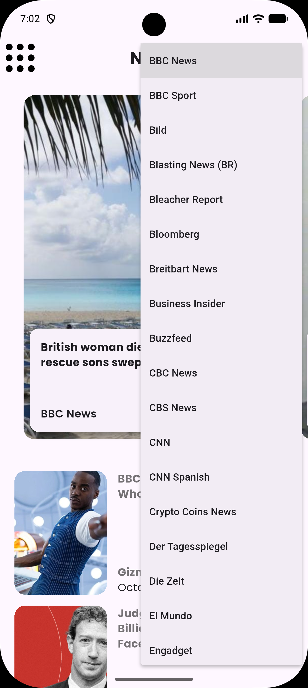
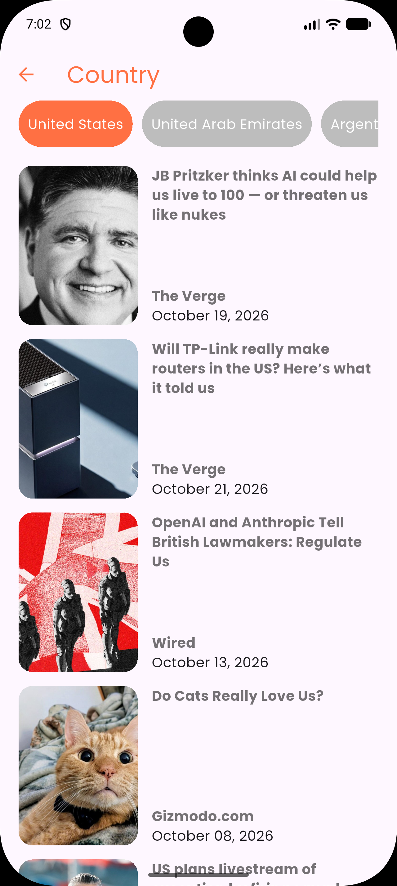
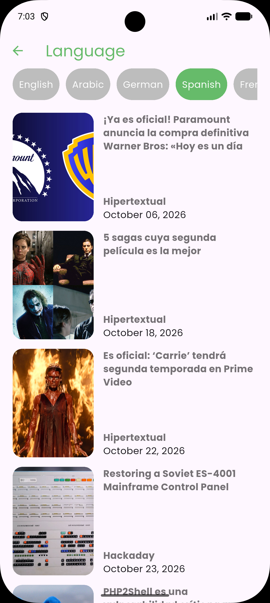
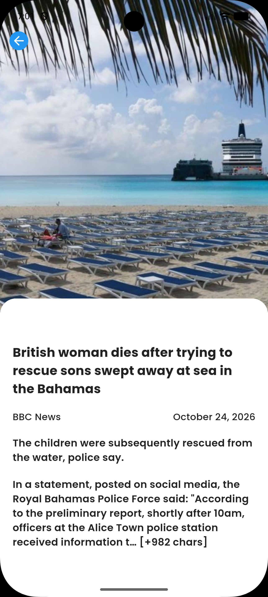

# Flutter News App

A Flutter app for browsing news headlines and articles by source, topic, country, and language. News content is provided by [NewsAPI](https://newsapi.org/).

## Screenshots

| Home | News sources |
| --- | --- |
|  |  |

| Categories | Category news |
| --- | --- |
|  |  |

| Country news | Language news |
| --- | --- |
|  |  |

### Article details



## Features

- View top headlines and browse news sources.
- Explore articles by category, country, and language.
- Open an article to view its available image, headline, source, publication date, description, and content.
- Load article images from the network with cached image support.

## Requirements

- Flutter SDK (Dart SDK `^3.13.3`, as specified in `pubspec.yaml`)
- A valid [NewsAPI](https://newsapi.org/) API key for live news data
- Internet access

## Getting started

1. Clone this repository and change into the project directory:

   ```bash
   git clone https://github.com/FAHIMSHAKIL102/Flutter-NEWS-App.git
   cd Flutter-NEWS-App
   ```

2. Configure the NewsAPI key used by `NewsRepository` in `lib/repository/news_repository.dart`. Do not commit a personal API key or publish it in a public repository.

3. Fetch dependencies and run the app:

   ```bash
   flutter pub get
   flutter run
   ```

To run the project checks:

```bash
flutter analyze
flutter test
```

## Project structure

```text
lib/
  bloc/          News event, state, and bloc files
  models/        NewsAPI response models
  repository/    NewsAPI HTTP requests
  view/          Splash, home, category, country, language, and article screens
  view_model/    UI-facing news data operations
  main.dart      App entry point
assets/
  images/        App imagery
  screens/       README screenshots
```

## Dependencies

- `http` for NewsAPI requests
- `cached_network_image` for loading article images
- `google_fonts` for typography
- `intl` for article date formatting
- `flutter_spinkit` for the splash-screen loading animation
- `bloc`, `flutter_bloc`, and `equatable` are included in the project dependencies

## NewsAPI note

NewsAPI availability, returned fields, and request limits depend on your API plan. The app needs a working API key and network access to load live content. For production deployments, avoid embedding API credentials in a client app; use a protected backend or another secure key-management approach.
